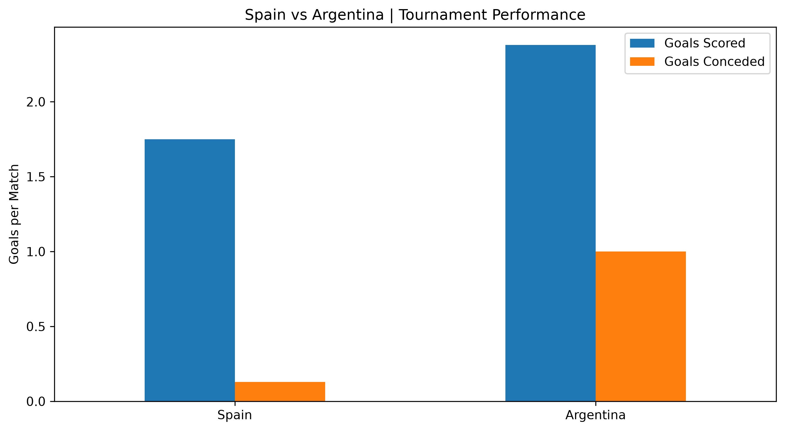
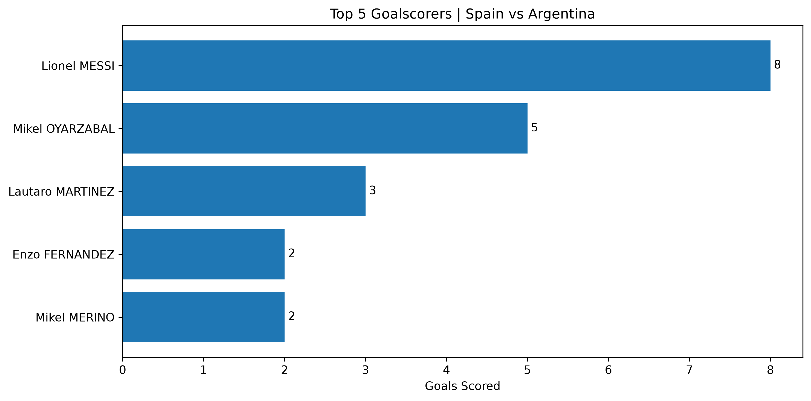
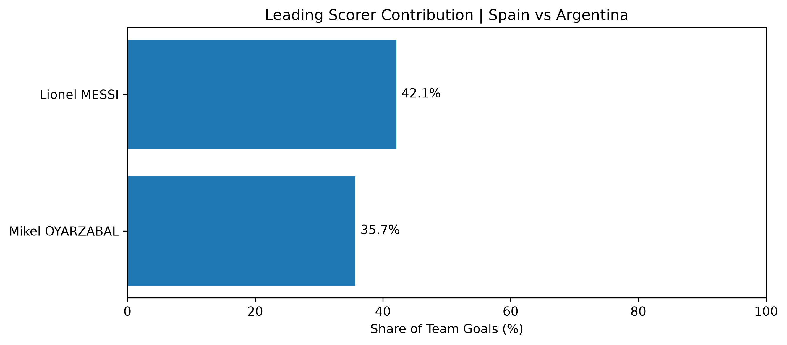
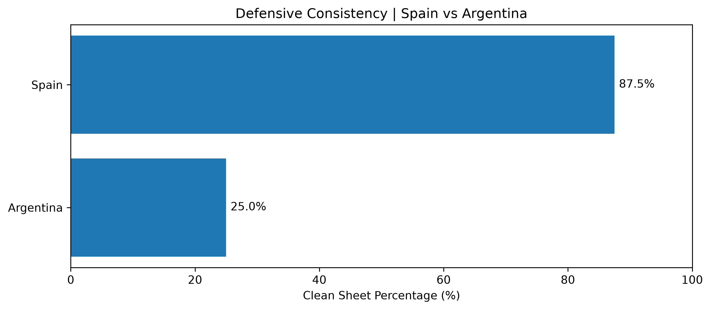

# World Cup 2026 | SQL Performance Analysis

### Spain vs. Argentina — Exploring the Numbers Behind Tournament Performance

**SQL · SQLite · Python · pandas · Matplotlib · Data Analytics**

## Project Overview

Can a team with fewer goals outperform a more aggressive attacking opponent?

This project explores that question through a comparative analysis of Spain and Argentina using a structured 2026 World Cup dataset.

My objective was to use SQL to investigate team performance, evaluate individual player contributions, validate the underlying data, and communicate meaningful findings through Python visualizations.

The analysis focuses on a simulated tournament scenario, with SQL serving as the primary analytical tool.

## Key Findings

| Metric | Spain | Argentina |
|---|---:|---:|
| Matches played | 8 | 8 |
| Wins | 7 | 7 |
| Goals scored | 14 | 19 |
| Goals conceded | 1 | 8 |
| Goal difference | +13 | +11 |
| Clean sheets | 7 | 2 |
| Clean-sheet rate | 87.5% | 25.0% |
| Leading scorer | Mikel Oyarzabal | Lionel Messi |
| Leading scorer's goals | 5 | 8 |

### What stood out?

**1. Defense made the difference.** Spain conceded just one goal across eight matches, compared with Argentina's eight. Spain's 87.5% clean-sheet rate was the most striking distinction between the teams.

**2. Argentina had the stronger attack.** Argentina averaged 2.38 goals per match, compared with Spain's 1.75, but finished behind Spain in the simulated tournament.

**3. Argentina relied more heavily on its leading scorer.** Lionel Messi contributed 42.1% of Argentina's total goals, while Mikel Oyarzabal contributed 35.7% of Spain's.

**4. Data reconciliation improved accuracy.** Initial player-event totals did not match team-level goals. SQL validation identified an opponent own goal benefiting each team, resolving both discrepancies.

## Visualizations

### Team Performance



### Top Five Goalscorers



### Leading Scorer Dependency



### Defensive Consistency



## Dataset & Attribution

**Dataset:** [World Cup 2026 Open Match Data](https://github.com/Alamyy/Worldcup26)

**Creator:** Hesham El Alamy / Alamy AI

**Underlying source:** FIFA Training Centre post-match reports

**License:** Creative Commons Attribution 4.0 (CC BY 4.0)

The original repository provides structured match, team, and player-level data, including 104 matches, 48 teams, and 1,277 player records.

For this project, I organized the relevant data in SQLite and developed SQL queries to explore tournament results, player performance, and data consistency.

**Important:** This portfolio presents the results as a simulated analytical scenario rather than verified real-world tournament outcomes.

## Analytical Approach

The project follows seven stages:

| Notebook | Focus |
|---|---|
| 01 — Database Setup | Importing data and building SQLite tables |
| 02 — Data Exploration | Understanding tables and relationships |
| 03 — Data Quality | Validating records and identifying inconsistencies |
| 04 — Team Performance | Analyzing results, attacking output, and defense |
| 05 — Player Performance | Evaluating goals, appearances, and scoring efficiency |
| 06 — Data Visualization | Communicating SQL findings through charts |
| 07 — Executive Summary | Consolidating conclusions and limitations |

## Technical Skills Demonstrated

- **SQL:** Joins, CTEs, aggregations, conditional logic, subqueries, and window functions
- **Data quality:** Validation, relational integrity, and goal reconciliation
- **Python:** pandas for SQL integration and Matplotlib for visualization
- **Database management:** SQLite and relational data modeling
- **Communication:** Analytical interpretation, visual storytelling, and documentation

## Repository Structure

```text
world-cup-2026-analysis/
├── Data/
│   ├── Raw/
│   └── Prepared/
├── Scripts/
│   ├── 01_Database_Setup.ipynb
│   ├── 02_Data_Exploration.ipynb
│   ├── 03_Data_Quality.ipynb
│   ├── 04_Team_Performance.ipynb
│   ├── 05_Player_Performance.ipynb
│   ├── 06_Data_Visualization.ipynb
│   └── 07_Executive_Summary.ipynb
├── Outputs/
│   ├── Charts/
│   └── Tables/
└── README.md
```

## How to Explore the Project

Start with `01_Database_Setup.ipynb` to understand the database preparation process.

Continue through the numbered notebooks to follow the analysis from data exploration to player performance and visualization.

The `Outputs` folder contains exported PNG charts and CSV tables for reviewing the findings without executing the notebooks.

To reproduce the analysis, use Python with pandas, Matplotlib, and JupyterLab, and run the notebooks in sequence with the source data available under the expected project paths.

### Installation

Install the required Python packages:

```bash
pip install -r requirements.txt
```

## Conclusion

The simulated results highlight how defensive consistency can distinguish successful teams even when their opponents demonstrate greater attacking output.

Beyond the football findings, this project demonstrates how I approach analytical problems: understanding the data, validating assumptions, using SQL to investigate patterns, and communicating conclusions clearly.
